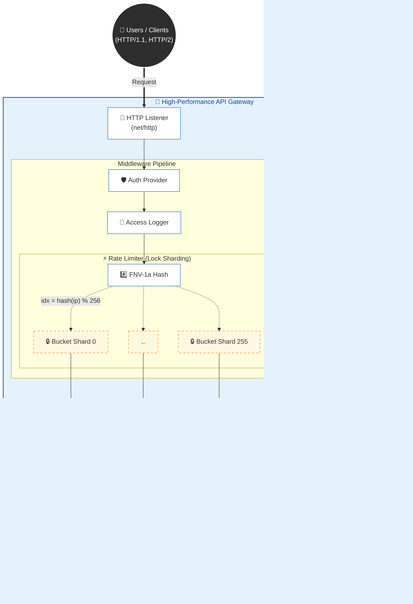

# 🚀 Go-based High-Performance API Gateway
> **Project Goal:** Go 언어의 동시성 모델을 활용한 고성능, 경량화 MSA 게이트웨이 구축  
> **Key Achievement:** 락 샤딩(Lock Sharding) 기법 적용으로 **Rate Limiter 모듈의 동시성 처리 성능 1.84배 향상** (Global Lock 대비)

---

## 📑 목차 (Table of Contents)
1. [프로젝트 개요 (Overview)](#1-프로젝트-개요-overview)
2. [기술 선정 및 아키텍처 (Tech Stack & Architecture)](#2-기술-선정-및-아키텍처-tech-stack--architecture)
3. [핵심 엔지니어링 과제 (Core Engineering Challenges)](#3-핵심-엔지니어링-과제-core-engineering-challenges)
    - 3.1. 무중단 설정을 위한 Atomic Hot-Swap (Dynamic Routing)
    - 3.2. 글로벌 락 경합 해결을 위한 Sharded Rate Limiter
4. [성능 최적화 및 검증 (Performance & Benchmark)](#4-성능-최적화-및-검증-performance--benchmark)
5. [안전성 검증 전략 (Quality Assurance)](#5-안전성-검증-전략-quality-assurance)

---

## 1. 프로젝트 개요 (Overview)
마이크로서비스 아키텍처(MSA) 환경에서 수많은 클라이언트 요청을 라우팅하고, 비즈니스 로직 앞단에서 **인증(Auth), 트래픽 제어(Rate Limit)** 등 공통 관심사(Cross-cutting Concerns)를 처리하기 위해 개발된 Go 기반 API Gateway입니다.

- **Non-Blocking I/O:** Go 런타임 스케줄러를 활용한 효율적인 연결 처리
- **Dynamic Configuration:** 서비스 중단 없는(Zero-downtime) 라우팅 규칙 변경
- **Fault Tolerance:** 장애 격리를 통한 시스템 안정성 확보

---

## 2. 기술 선정 및 아키텍처 (Tech Stack & Architecture)

### 🛠 기술 스택 의사결정 (Technical Decision)
| 카테고리 | 기술 | 선정 이유 |
|:---:|:---:|:---|
| **Language** | **Go (1.21+)** | - **Goroutine:** 스레드 대비 적은 메모리 오버헤드로 높은 동시성 구현<br>- **Channel:** CSP 모델을 통한 안전한 데이터 동기화<br>- **Standard Lib:** 외부 의존성을 최소화한 순수 `net/http` 활용 |
| **Routing** | **Reverse Proxy** | `httputil.ReverseProxy`를 확장하여 커스텀 로드밸런싱 로직 주입 |
| **Consistency** | **Atomic / Mutex** | Read-Heavy 워크로드에 최적화된 `sync.RWMutex` 및 `sync/atomic` 활용 |
| **Testing** | **Go Toolchain** | `testing` 패키지와 `-race` 감지기를 활용한 통합 테스트 파이프라인 |


### 🏗 시스템 구조 (System Design)


---

## 3. 핵심 엔지니어링 과제 (Core Engineering Challenges)

### 3.1. 무중단 설정을 위한 Atomic Hot-Swap
- **문제(Problem):** 게이트웨이는 24시간 가동되어야 합니다. 새로운 마이크로서비스가 배포되거나 IP가 변경될 때, 서버를 재시작하면 다운타임이 발생합니다.
- **해결(Solution):** **RWMutex** 기반의 Hot-Swap 메커니즘을 구현했습니다.
    - 요청 처리(Serving)는 `RLock()`을 통해 **병렬적**으로 수행됩니다.
    - 설정이 변경될 때만 `Lock()`(Write Lock)을 획득하여 라우팅 테이블 포인터를 교체합니다.
    - 이를 통해 **설정 변경 중에도 기존 요청들은 안전하게 처리**됩니다.

### 3.2. 글로벌 락 경합 해결을 위한 Sharded Rate Limiter
- **문제(Problem):** 초당 수만 건의 요청이 들어올 때, 모든 IP 접속 기록을 하나의 `map`과 하나의 `Mutex`로 관리하면, **Lock Contention(자물쇠 쟁탈전)**으로 인해 CPU가 대기 상태에 빠지는 현상이 발생했습니다.
- **해결(Solution):** **Sharding(Lock Striping)** 기법을 도입했습니다.
    ```go
    // Shard 결정 알고리즘 (FNV-1a Hashing)
    idx := fnv32(ip) % 256
    shards[idx].mu.Lock() // 해당 파편만 잠금
    ```
    - 전체 저장소를 256개의 독립된 'Shard'로 분할했습니다.
    - 요청자는 자신의 IP가 속한 Shard의 자물쇠만 획득하면 됩니다.
    - 따라서 서로 다른 Shard에 속한 요청자들은 **완벽하게 병렬로 처리**됩니다.

---

## 4. 성능 최적화 및 검증 (Performance & Benchmark)

"락을 쪼개는 구조가 더 복잡한데, 실제로 얼마나 빨라지는가?"를 증명하기 위해 **Micro-benchmark**와 **System Load Test** 두 가지 차원에서 검증을 진행했습니다.

### 4.1. Micro-benchmark: 락 경합 해소 효과
동일한 로직에 대해 **단일 락(Global Lock)** 방식과 **샤딩 락(Sharded Lock)** 방식의 순수 알고리즘 성능을 비교했습니다.

| 구현 방식 | 연산 횟수 (Ops) | 연산 당 소요 시간 (ns/op) | 메모리 할당 (B/op) |
|:---:|:---:|:---:|:---:|
| **Global Lock (Control)** | 8,738,534 | **117.3 ns** | 21 B |
| **Sharded Lock (Target)** | 19,200,345 | **63.58 ns** | 21 B |

> **📉 결과 분석:**
> - 지연 시간(Latency): 117ns → 63.5ns (**약 46% 감소**)
> - 처리량(Throughput): **약 1.84배 성능 향상**
> - 결론: 해싱 연산 비용(Overhead)보다 동시성 경합(Contention)을 제거한 이득이 훨씬 큼을 정량적으로 증명함.

### 4.2. System Load Test (Integrated Benchmark)
실제 HTTP 서버를 구동하고 네트워크 스택(Loopback TCP)을 포함한 전체 파이프라인(Auth -> RateLimit -> Router -> Proxy)의 처리량을 측정했습니다.

> **⚠️ Note on Methodology:**  
> 본 테스트는 `httptest` 패키지를 활용한 Loopback 통합 테스트 결과입니다. 실제 네트워크 구간의 Latency와 OS Kernel Network Stack의 오버헤드는 최소화된 환경이며, 순수 애플리케이션 로직의 최대 처리량을 검증하는 데 목적을 두었습니다.

- **Test Environment:** macOS, Apple M2, 8 Cores
- **Concurrency:** `GOMAXPROCS=8`
- **Metric:** RPS (Requests Per Second)

```text
Benchmark_Integrated_System-8    39,400 ops    26,417 ns/op
=> Avg: ~37,854 RPS
```

> **🚀 결과 해석:**
> - 단일 노드(8 Cores)에서 **초당 약 3.7만 건**의 요청 처리 가능함을 확인.
> - 요청 당 평균 처리 시간(Latency)은 **0.026ms** (Loopback 기준, 백엔드 지연 제외).
> - 미들웨어 체인(Auth, RateLimit)이 포함된 상태에서도 충분한 처리량을 확보하여, 병목이 애플리케이션 로직에 있지 않음을 증명.

---

## 5. 안전성 검증 전략 (Quality Assurance)
**"빠른 시스템보다 안전한 시스템"**을 목표로, 동시성 이슈 발생 가능성을 사전에 차단했습니다.

1.  **Unit Tests:** 라우팅 로직, 로드밸런싱 알고리즘 검증 (Total 6 Scenarios Passed).
2.  **Race Detection:** `go test -race`를 통해 Hot-Swap 및 Rate Limiter 동작 시 Data Race가 발생하지 않음을 보증.
3.  **Consistency Verification:** 포인터 주소 비교를 통해 의도한 대로 Shard Lock이 독립적으로 동작하는지 디버깅 검증 완료.

---

### 🔮 Future Works
- [ ] **Distributed Rate Limiter:** Redis Lua Script를 활용한 클러스터 단위 속도 제한
- [ ] **Observability:** Prometheus Metrics Exporter 구현 (Latency, Error Rate 등)
- [ ] **Circuit Breaker:** 연동된 서비스 장애 시 Fail-fast 메커니즘 도입
